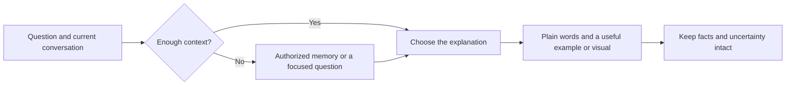

<p align="center"></p>
<h1 align="center">Human, please</h1>
<p align="center"><strong>Make complex things click.</strong><br>Adaptive explanations in your language, at your level, without talking down to you.</p>
<p align="center"><strong>English</strong> · <a href="README.ru.md">Русский</a></p>

<p align="center">
<a href="https://github.com/letya999/human-please/actions/workflows/check.yml"></a>
<a href="LICENSE"></a>
<a href="https://github.com/letya999/human-please/releases"></a>
<a href="human-please/SKILL.md"></a>
</p>


You ask what the agent is fixing. It answers with goroutines, mutexes, pods and ledgers. You ask again. **Human, please** helps it explain what is happening, why it matters, what has actually been checked, and what remains.

For project managers, product people, curious builders, and technical specialists exploring an unfamiliar topic. Your knowledge differs from question to question. The skill adapts to this question and your current conversation.

## Quick start

Install with the [skills CLI](https://github.com/vercel-labs/skills):

```sh
npx skills@1.7.2 add letya999/human-please --skill human-please -a codex -a claude-code
```

Add `-g` for a user-wide installation. Omit the agent flags to choose another supported host interactively. The CLI needs Node.js/npm. The skill itself has no runtime dependencies, service or API key.

Ask naturally in your language:

> Explain this in plain language. What are we fixing, what did we verify, and what is left?

For explicit activation in hosts supporting `$skill-name`:

```text
$human-please Explain what changed and why it matters to the user.
```

Automatic activation depends on the agent and model. Preview discovery without installing:

```sh
npx skills@1.7.2 add letya999/human-please --list
```

<details>
<summary>Manual installation and release archive</summary>

Copy `human-please/` into your host's documented skill directory. Keep `SKILL.md`, `LICENSE`, and all three files in `references/`. Evaluation fixtures and repository documentation are unnecessary at runtime.

The [release](https://github.com/letya999/human-please/releases/latest) includes a ZIP-format `.skill` bundle and SHA-256 checksum. Extract it manually if your host does not accept `.skill` directly. Installation cannot add history tools or visual renderers that your host lacks.

</details>

## Before → after

**Before**

> A mutex serializes concurrent refresh goroutines; unit tests pass, but upstream integration remains unverified.

**With Human, please** — illustrative output, not a recorded run:

> Two refresh attempts could run at the same time. We changed them to take turns, like people sharing one checkout counter.
>
> Our separate checks passed. We still need to check the real external service before saying the whole connection works. Nothing needs your approval right now.

Taking turns does not itself prove that the returned data is correct. Simplification must preserve that distinction.

## Four useful moments

| When you ask… | What the explanation should do |
| --- | --- |
| “What does this mean?” | Build from familiar knowledge; define necessary terms. |
| “I understood nothing. Try again.” | Find the missing step and change the framing or example. |
| “Where are we with this project?” | Reconnect the goal, discoveries, changes, checks and remaining work. |
| “Which option should I approve?” | Explain consequences, alternatives and uncertainty in practical terms. |

## How it finds your language



- **Start here.** Current language, knowledge of this topic, purpose and feedback come first.
- **Look further for a real gap.** If authorized and available, consult memory and three recent sessions; expand to five, then at most eight only when needed. Keep the reader profile temporary.
- **Choose the method for the question.** Worked example, causal chain, before/after, analogy, Feynman-style simplification or an adapted four-cause explanation. Use the method without announcing famous names.
- **Use the available canvas.** Text, tables and diagrams depend on the question and actual renderer. No mandatory image generator or visualization service.
- **Respect the person.** Follow stated age, accessibility needs and preferences. Do not infer diagnoses, intelligence or age from writing style.

Instructions stay in English. Answers follow the reader's current language preference. Host permissions still govern history access. See [security and privacy](SECURITY.md).

## What is inside

| File | Purpose |
| --- | --- |
| [SKILL.md](human-please/SKILL.md) | Trigger, routing and delivery rules. |
| [Context](human-please/references/context.md) | Preferences, bounded memory search and fallback. |
| [Methods](human-please/references/methods.md) | Techniques, factual fidelity and repair. |
| [Visuals](human-please/references/visuals.md) | Useful forms supported by the current host. |
| [Evaluations](human-please/evals/) | Synthetic scenarios and multilingual triggers. |
| [Testing guide](docs/testing.md) | Structural, behavioral and discovery checks. |

## Evidence, with limits

The 0.2.0 comparison used five synthetic scenarios in fresh native contexts: **14/15 → 15/15 assertions**, with no observed regressions. The improvement concerned unnecessary reference reads; it does not establish a general improvement in clarity. Repeated probes still found inconsistent selective reading. [Full report](reports/human-please-0.2.md).

Local packaging tests passed. CI checks packaging on Linux and Windows and runs CLI discovery. Neither proves reliable automatic activation, real memory integration or rendering in every host. A Markdown skill guides a model; it cannot guarantee its behavior.

## Develop and contribute

Changes flow **feature branch → dev → main**. `main` is the stable default branch. Python 3.12+ and its standard library are sufficient for maintenance:

```sh
python -m json.tool skills.sh.json
python tools/maintain.py
python -m unittest discover -s tests -v
```

Build outputs go to `dist/`. See [CONTRIBUTING](CONTRIBUTING.md), [AGENTS](AGENTS.md), [changelog](CHANGELOG.md) and [publication guide](docs/publishing.md). The official `skills.sh.json` customizes the directory page; publication does not guarantee a [skills.sh listing](https://skills.sh/docs/faq).

## More skills by the author

[Test Designer](https://github.com/letya999/test-designer) · [Test Critic](https://github.com/letya999/test-critic) · [Prose Polish RU](https://github.com/letya999/prose-polish-ru). Each is independent and optional.

## License and artwork

[MIT](LICENSE). Instructions are original; background sources appear in [Methods](human-please/references/methods.md). The icon and banner were generated with OpenAI image generation and visually reviewed. [Asset notes and prompts](assets/README.md) document their provenance. No exclusive copyright or trademark rights in generated artwork are claimed.
