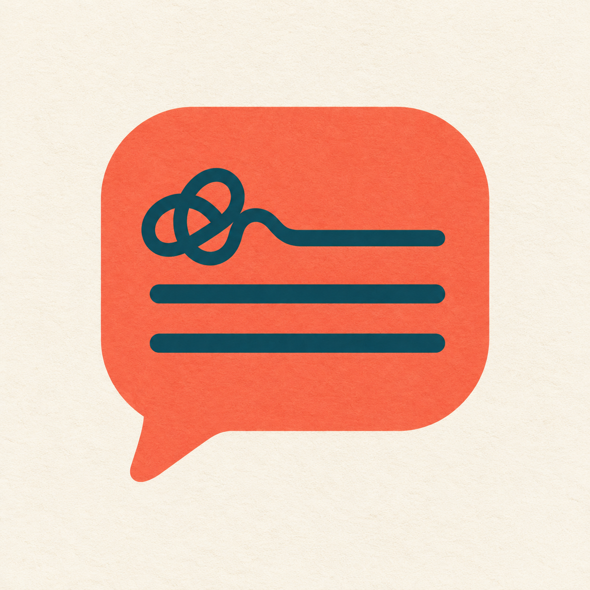
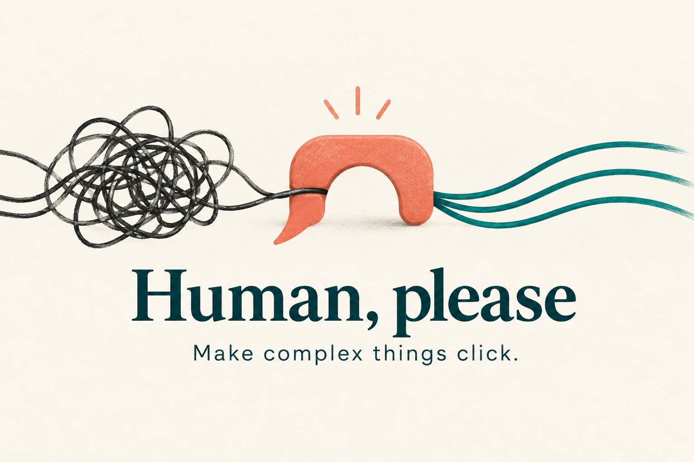

<p align="center"></p>
<h1 align="center">По-человечески, пожалуйста</h1>
<p align="center"><strong>Human, please — чтобы сложное стало понятным.</strong><br>На твоём языке, с учётом твоих знаний, без снисходительности.</p>
<p align="center"><a href="README.md">English</a> · <strong>Русский</strong></p>

<p align="center">
<a href="https://github.com/letya999/human-please/actions/workflows/check.yml"></a>
<a href="LICENSE"></a>
<a href="https://github.com/letya999/human-please/releases"></a>
<a href="human-please/SKILL.md"></a>
</p>



Ты спрашиваешь, что агент сейчас исправляет. В ответ — горутины, mutex, pods и ledger. Приходится спрашивать ещё раз. **Human, please** помогает объяснить суть: что происходит, зачем это нужно, что действительно проверили и что осталось.

Для проджектов, продактов, людей, создающих продукты с агентами, и технических специалистов в незнакомой области. Ты можешь отлично понимать один вопрос и впервые разбираться в другом — скилл учитывает именно текущий вопрос.

## Установка за минуту

Через [skills CLI](https://github.com/vercel-labs/skills):

```sh
npx skills@1.7.2 add letya999/human-please --skill human-please -a codex -a claude-code
```

Добавь `-g` для установки на уровне пользователя. Убери флаги агентов, чтобы выбрать другого поддерживаемого клиента в меню. Установщику нужен Node.js/npm. Сам скилл — это инструкции: ему не нужны сервис, API-ключ или отдельный аккаунт.

Дальше пиши как обычно:

> Объясни по-простому. Что мы сейчас чиним, что уже проверили и что ещё осталось?

Или вызови явно, если клиент поддерживает такой формат:

```text
$human-please Я потерял нить. Объясни, что изменилось и зачем это пользователю.
```

Подойдут просьбы вроде «объясни нетехнарю», «поясни доступно», «я ничего не понял, давай нормально» и их аналоги на других языках. Автоматическое срабатывание зависит от агента и модели.

<details>
<summary>Проверить доступность или установить вручную</summary>

Проверить обнаружение без установки:

```sh
npx skills@1.7.2 add letya999/human-please --list
```

Скопируй папку `human-please/` в каталог скиллов своего клиента. Сохрани `SKILL.md`, `LICENSE` и три файла в `references/`. Тестовые примеры и документация репозитория для работы не нужны.

В [релизе](https://github.com/letya999/human-please/releases/latest) есть ZIP-архив `.skill` и контрольная сумма SHA-256. Если клиент не принимает `.skill` напрямую, распакуй его вручную. Установка не добавляет клиенту отсутствующие инструменты истории или визуализации.

</details>

## Пример: было → стало

**Было**

> Mutex сериализует конкурентные refresh-горутины; unit-тесты зелёные, upstream-интеграция не верифицирована.

**С Human, please** — пример желаемого ответа, не запись тестового запуска:

> Две попытки обновить данные могли выполняться одновременно. Мы сделали так, чтобы они шли по очереди — как люди у одной кассы.
>
> Отдельные проверки прошли. Работу с настоящим внешним сервисом ещё нужно проверить, поэтому пока рано говорить, что всё соединение работает. Решение от тебя сейчас не требуется.

Очередь сама по себе ещё не доказывает правильность данных. Понятное объяснение сохраняет это различие.

## Когда пригодится

| Твой вопрос | Что должно стать понятным |
| --- | --- |
| «Что это вообще значит?» | Суть и механизм через знакомые понятия. |
| «Ничего не понял, объясни нормально» | Пропущенный шаг, другой пример или более подходящая структура. |
| «Что у нас сейчас с проектом?» | Цель, находки, изменения, проверки и оставшаяся работа. |
| «Какой вариант мне согласовать?» | Последствия выбора, ограничения и рекомендация с опорой на факты. |

## Как он подстраивается

1. **Начинает с текущего разговора:** язык, знания по этому вопросу, цель и твоя реакция.
2. **Ищет контекст при необходимости:** доступная память и три последние сессии; затем пять и максимум восемь, если конкретный пробел ещё остался. Доступ должен быть разрешён. Профиль читателя не сохраняется.
3. **Выбирает подходящий приём:** конкретный пример, цепочку причин, «до / после», аналогию, упрощение в духе Фейнмана или разбор устройства и назначения по мотивам четырёх причин Аристотеля.
4. **Использует подходящую форму:** текст, список, таблицу или схему — с учётом возможностей текущего клиента.
5. **Сохраняет уважение и точность:** учитывает явно названные возрастные и доступностные потребности; не угадывает диагнозы, интеллект или возраст по манере письма.

Инструкции скилла — на английском. Ответы — на языке, который тебе сейчас нужен. Если информации мало, агент может задать один конкретный вопрос твоими словами. Подробнее: [приватность и безопасность](SECURITY.md).

## Что внутри

| Файл | Зачем нужен |
| --- | --- |
| [SKILL.md](human-please/SKILL.md) | Когда включаться и как строить ответ. |
| [Контекст](human-please/references/context.md) | Предпочтения, память и ограниченный поиск по истории. |
| [Приёмы](human-please/references/methods.md) | Способы объяснения и исправления непонятного ответа. |
| [Визуализация](human-please/references/visuals.md) | Когда нужна схема и какие инструменты доступны. |
| [Оценочные сценарии](human-please/evals/) | Вымышленные ситуации и многоязычные запросы. |

## Проверки и честные ограничения

В сравнении версии 0.2.0 на пяти вымышленных сценариях результат изменился с **14/15 до 15/15 критериев**, без обнаруженных регрессий. Улучшение касалось лишнего чтения справочных файлов. Это маленькая выборка; она не доказывает, что любые объяснения стали лучше. Повторные прогоны показали, что выборочное чтение всё ещё соблюдается непоследовательно. [Подробный отчёт](reports/human-please-0.2.md).

Локальные тесты упаковки прошли. CI проверяет сборку на Linux и Windows и обнаружение через CLI. Это не доказательство надёжного автозапуска, работы с настоящей памятью или визуализации во всех клиентах. Скилл направляет модель, но не гарантирует её поведение.

## Участие в разработке

Ветки: **feature → dev → main**. Стабильная ветка по умолчанию — `main`. Для локальных проверок достаточно Python 3.12+:

```sh
python -m json.tool skills.sh.json
python tools/maintain.py
python -m unittest discover -s tests -v
```

[Правила участия](CONTRIBUTING.md) · [Инструкции агентам](AGENTS.md) · [История изменений](CHANGELOG.md) · [Проверки](docs/testing.md) · [Публикация](docs/publishing.md).

## Другие скиллы автора

[Test Designer](https://github.com/letya999/test-designer) помогает выбирать проверки, [Test Critic](https://github.com/letya999/test-critic) — разбирать написанные тесты, а [Prose Polish RU](https://github.com/letya999/prose-polish-ru) — редактировать русские тексты. Они устанавливаются отдельно и не нужны для работы Human, please.

## Лицензия и иллюстрации

[MIT](LICENSE). Инструкции оригинальные; источники подходов указаны в [справочнике](human-please/references/methods.md). Иконка и обложка созданы с помощью генерации изображений OpenAI и просмотрены для проекта. [Описание и промпты](assets/README.md) сохранены отдельно. Исключительные права на сгенерированные изображения и регистрацию товарного знака проект не заявляет.
